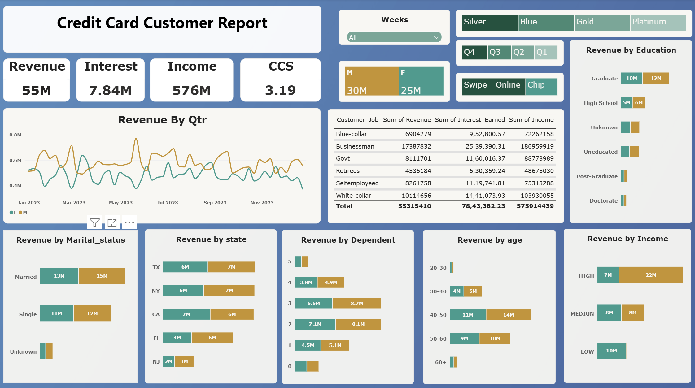
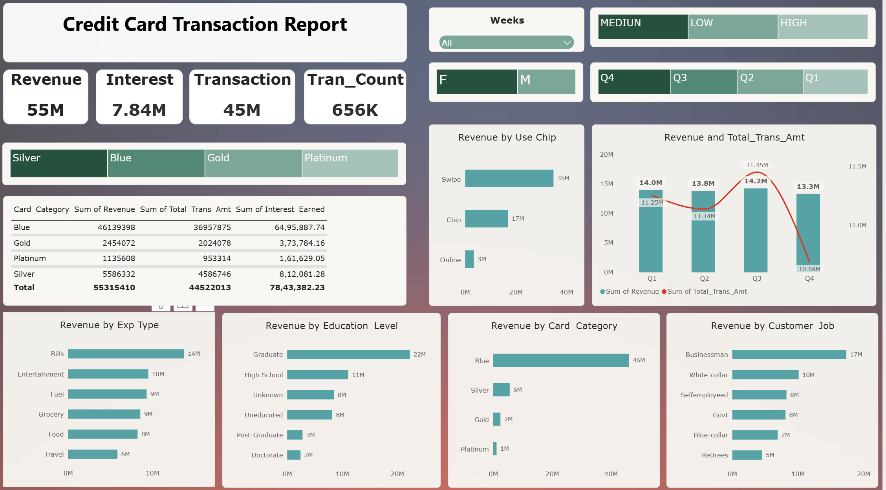

# Credit Card Analysis | Power BI Dashboard

**Tools:** Power BI, DAX, SQL (DBeaver) | **Period:** Jan-Dec 2023

**Headline:** 55.3M revenue, 7.84M interest, 44.5M transaction amount, 656K transactions.

## Key Insights
1. **Blue card drives 83% of revenue** (46.1M of 55.3M) and 83% of interest. Gold and Platinum together contribute only 6.5%.
2. **Swipe is the dominant channel at 63%** of revenue (35M), followed by Chip (31%). Online is just 5%, the clearest growth gap.
3. **Males generate 54% of revenue** (30M vs 25M). In the high-income segment the gap widens to 22M vs 7M.
4. **Ages 40-60 account for about 80% of revenue**, and graduates alone contribute about 40% (22M).
5. **Businessmen are the top segment at 31%** (17.4M), well ahead of White-collar (10.1M).
6. **Q4 is the weakest quarter.** Revenue fell 6% from Q3 (14.2M to 13.3M), and transaction amount dropped from 11.45M to 10.69M.
7. **Bills are the top expense type at 14M** (about 25%). Travel is lowest at 6M.
8. **TX, NY and CA contribute about 70% of revenue** (13M each).

## Dashboard Preview

 

